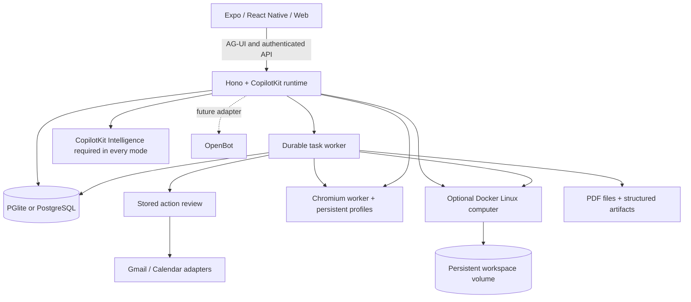

  <div align="center">

# MyMuse

**A personal agent with a browser, terminal, files, and work that keeps going. Compatible with any agent harness.**

Ask for an outcome. Follow the plan, review actions, and come back to the result.
Built with CopilotKit React Native for iOS, Android, and web.

[Quick start](#quick-start) · [Demo](#demo) · [Features](#features) · [Architecture](#architecture) · [Docs](docs/README.md) · [Contributing](CONTRIBUTING.md)

[](https://github.com/CopilotKit/openfuse/actions/workflows/ci.yml)
[](LICENSE)

<a href="https://trendshift.io/repositories/254992?utm_source=trendshift-badge&amp;utm_medium=badge&amp;utm_campaign=badge-trendshift-254992" target="_blank" rel="noopener noreferrer"></a>

[](https://render.com/deploy?repo=https://github.com/CopilotKit/openfuse)

Clone this template and customize it however you want.

**[Building on MyMuse? Meet with the CopilotKit team →](https://www.copilotkit.ai/talk-to-an-engineer?ref=mymuse_hero)**

</div>

> **Alpha, for self-hosting and building on.** Open-ended reasoning, live Google accounts, and CopilotKit Rich Threads require their own configuration. See [what is verified](docs/VERIFICATION.md) and the [roadmap](ROADMAP.md).

## Demo

On iPhone, ask MyMuse to find interesting stories on Hacker News and summarize CopilotKit. On desktop, ask it to check the school-trip email, open the message, and research exhibits at Monterey Bay Aquarium. The agent shows email and browser results inline. **Take control** opens that same browser session when you need it.

The send arrow becomes a stop square inside the input pill while the agent replies, then switches back. Stopping keeps your draft intact. See the [recording notes](docs/DEMO.md) for the model setup and reproduction steps.

[Recording details and reproduction](docs/DEMO.md)

The [Jev aquarium-trip demo](docs/demos/jev-generative-ui.md) walks through a fictional school email, clarification choices, sourced exhibit cards, hands-on preference refinement, and a confirmed selection.

## What it is

MyMuse is a personal-agent application with an agent computer, visible work, and rich results. It runs its own server, task worker, and browser worker. You can inspect and change the source under the MIT license.

The computer combines **persistent Chromium and an optional Linux workspace**. The agent can browse public pages, run commands in its own container, work with files, and move PDFs between the computer and the app. You can open its browser or terminal and continue the work. Graphical desktops and autonomous checkout remain future work.

## Features

| Surface | What runs in this alpha |
| --- | --- |
| **Chat** | CopilotKit headless chat with streamed AG-UI events, mailbox search and reading, send/stop in one input pill, a visible follow-up queue, retained drafts, delegated tasks, and inline email, browser, PDF, plan, and finance cards. |
| **Agent computer** | Persistent browser profiles and takeover console; optional isolated Linux terminal, saved command receipts, editable workspace files, and PDF transfer. |
| **Activity** | Durable task plans, progress, input requests, pause/resume/cancel/retry, approvals, and saved receipts. SQL leases recover interrupted work. |
| **Ideas** | Suggestions with source evidence; edit, accept, or dismiss. Sent replies and completed matching work are excluded. |
| **Goals & Tracking** | Goals and milestones; recurring public-page checks for changes, text availability, or USD price thresholds, with deduplicated alerts and failure backoff. |
| **Documents** | Email attachment → PDF → requested form values → filled copy → reviewed reply → receipt. Native/web PDF viewing, paging, zoom, supported fields, and sharing. |
| **Finance** | Import transaction CSV to create a spending summary with categories, transactions, and a savings-goal action. |
| **Gmail & Calendar** | Google OAuth adapters, complete mail threads, drafts/attachments, calendar discovery, and reviewed event creation/update/deletion. Live credentials required. |
| **Personal context** | Editable name, tone, avatar, and memories. Background-update preferences and durable in-app notifications. |
| **Rich Threads** | CopilotKit Intelligence persistence in every mode, with a stable main conversation, side chats, renaming, archiving, restoring, and replay. A server-only project key is required. |

The [feature inventory](docs/FEATURES.md) describes implemented capabilities and planned extensions. Health/bank/social connectors, device push, voice, generated executable tools, and automatic reservations/payments are on the [roadmap](ROADMAP.md).

## Quick start

**Requirements:** Node 24 LTS, pnpm 11.19.0, and a CopilotKit Intelligence project key. The local sample app needs no model, Google account, or Docker.

```sh
git clone https://github.com/Hamza35779/openmuse.git openmuse
cd openmuse
```

Your clone's `origin` points at your fork ([Hamza35779/openmuse](https://github.com/Hamza35779/openmuse)). Add the original project as `upstream` so you can pull in its changes:

```sh
git remote add upstream https://github.com/CopilotKit/openfuse.git
```

Enable the pinned package manager, install, and configure the environment:

```sh
corepack enable
corepack prepare pnpm@11.19.0 --activate
pnpm install --frozen-lockfile
cp .env.example .env
npx copilotkit@latest login
npx copilotkit@latest project select
# Set CPK_INTELLIGENCE_API_KEY in .env to the generated server-only project key.
# Keep the CLI-generated CPK_TELEMETRY_ID too, including in deployed server environments.
pnpm dev
```

In another terminal:

```sh
pnpm dev:web
```

Open [localhost:8081](http://localhost:8081). The API runs at [localhost:8787/api/health](http://localhost:8787/api/health).

If `corepack` is unavailable, install the pinned version directly with `npm install -g pnpm@11.19.0`. With `nvm` or `fnm` on macOS or Linux, `nvm install 24` (or `fnm install 24`) selects the required Node release.

### Work on your own copy

Commit and push to your own fork:

```sh
git add -A
git commit -m "Describe the change"
git push origin main
```

Pull in changes from the original project without changing your remote:

```sh
git fetch upstream
git merge upstream/main
git push origin main
```

### Try it

1. In Chat, send **“Complete the permission slip”**. Open the task, supply fictional form values, inspect the saved PDF, and review the prepared reply. This writes only to the local mailbox.
2. In **Goals → Track**, create a built-in availability watch, then change the built-in test page to trigger an alert.
3. In **Menu → Delegate task → Finance**, use **Try example transactions** to create an interactive spending tracker.
4. Start the [browser worker](#browser-worker) and configure a model, then ask **“Check out Hacker News for cool stuff”** or **“Summarize copilotkit.ai”**. Follow the browser inline and use **Take control** to open its session. For a model-free version of this flow, follow the [AI Mock demo setup](docs/DEMO.md#run-the-agent-browser-demo).

For iOS or Android, use `pnpm --dir apps/mobile ios` or `pnpm --dir apps/mobile android`. Xcode or Android tooling is required. The PDF reader needs an Expo development build; use [native setup](apps/mobile/README.md).

## Installable apps

Both desktop and mobile builds are clients for an API server. Set `EXPO_PUBLIC_API_URL` to a reachable server (for example your Render URL) when you build; the default is `http://localhost:8787`.

### Desktop (Windows, macOS, Linux)

The desktop app wraps the web client in an Electron shell (`apps/desktop`).

```sh
pnpm build:desktop:win    # NSIS installer, portable .exe, .msi
pnpm build:desktop:mac    # .dmg and .zip
pnpm build:desktop:linux  # .AppImage and .deb
```

Artifacts land in `apps/desktop/release`. Run each target on its own operating system: `.msi` and `.dmg` cannot be produced elsewhere, while the `.exe` targets also build on Linux with Wine and Xvfb (`xvfb-run -a pnpm --dir apps/desktop exec electron-builder --win nsis portable`). Builds are unsigned unless you provide signing credentials, so Windows SmartScreen and macOS Gatekeeper warn on first launch. Installers are also attached by the [Release workflow](#github-actions-builds). See [apps/desktop/README.md](apps/desktop/README.md).

### Android and iOS

Mobile installers are built with [EAS Build](https://docs.expo.dev/build/introduction/) using `apps/mobile/eas.json`.

```sh
npx eas-cli login
npx eas-cli init          # links the project and writes extra.eas.projectId
pnpm build:apk            # preview profile: installable .apk
pnpm build:ipa            # preview profile: installable iOS build
```

Both commands print a download link when the cloud build finishes. iOS builds need an Apple Developer account and a registered device; EAS prompts for credentials on the first run. For store submissions use `pnpm --dir apps/mobile dist:store`, which builds an Android App Bundle and an App Store IPA. To point a cloud build at your server, add `"env": { "EXPO_PUBLIC_API_URL": "https://your-api.example.com" }` to the chosen profile in `apps/mobile/eas.json`.

EAS needs an Expo account and Apple credentials. The release workflow therefore builds the same two formats on GitHub runners instead, with no account required: `expo prebuild` generates the native projects, Gradle builds an APK signed with the debug keystore, and Xcode builds an unsigned `.ipa`. The APK installs by sideloading (allow installs from unknown sources). The `.ipa` has to be re-signed with your Apple developer certificate and provisioning profile before a device accepts it — use Xcode, or `codesign`/`fastlane sigh` with your profile. Use EAS when you want store-ready, Apple-signed builds.

### GitHub Actions builds

Run **Actions → Release → Run workflow**, or push a `v*` tag. Four jobs build in parallel — the desktop matrix (Ubuntu, Windows, macOS), an Android APK via Gradle, and an iOS `.ipa` via Xcode on a macOS runner — and a final job uploads them as workflow artifacts.

A tag run additionally creates the [GitHub Release](https://github.com/Hamza35779/MyMuse/releases) for that tag and attaches every file built in the run (`.exe`, `.msi`, `.dmg`, `.zip`, `.AppImage`, `.deb`, `.apk`, `.ipa`), so the version becomes downloadable from the Releases page. The last job of a run lists what it published.

No repository secrets are required for those files: the mobile jobs generate their native projects locally with `expo prebuild` instead of calling EAS. The resulting APK is signed with the debug keystore and the `.ipa` is unsigned, so re-sign it with your Apple certificate before installing on a device.

### Store signing

The `production` profile in `apps/mobile/eas.json` builds an Android App Bundle and an App Store IPA with EAS-managed credentials (`"credentialsSource": "remote"`), and `submit.production` uploads them — Android to the Play internal track, iOS to App Store Connect. Both need accounts and signing material, so they run on your Expo, Apple and Google Play accounts, not on this repository.

One-time setup:

1. `npx eas-cli login`, then `npx eas-cli init` in `apps/mobile`, and commit the `extra.eas.projectId` it writes into `app.json`.
2. `npx eas-cli credentials` in `apps/mobile` and let EAS generate the Android keystore and the iOS distribution certificate and provisioning profile for `app.mymuse.mobile`. They stay on EAS servers; never commit them.
3. Add these repository secrets under **Settings → Secrets and variables → Actions**:

| Secret | Value |
| --- | --- |
| `EXPO_TOKEN` | A token from <https://expo.dev/settings/access-tokens>. |
| `EXPO_APPLE_ID` | Your Apple Developer account email. |
| `EXPO_APPLE_APP_SPECIFIC_PASSWORD` | An app-specific password from <https://appleid.apple.com>. |
| `EXPO_ASC_APP_ID` | The numeric Apple ID of the app in App Store Connect. |
| `EXPO_APPLE_TEAM_ID` | Your Apple Developer team ID. |
| `PLAY_SERVICE_ACCOUNT_JSON` | The Play Console service-account JSON, with release permission on the app. |

A tag run then builds the signed bundle and IPA, attaches `MyMuse-<tag>-store-android.aab` and `MyMuse-<tag>-store-ios.ipa` to the release, and submits each build by ID. The jobs skip with a notice while `EXPO_TOKEN` or `extra.eas.projectId` is missing, and each store upload only runs when its own secrets are present, so Android can ship before Apple is set up.

To check the APK actually runs, run **Actions → APK smoke test**. It builds the APK from the checkout, boots an Android 14 emulator, installs and launches it, then starts the sample API on the runner behind a logging proxy (`10.0.2.2:8787` inside the emulator is the runner's loopback) and fails unless the app opens a session by calling `POST /api/session`. Add a `CPK_INTELLIGENCE_API_KEY` repository secret and the run also loads the real conversation store; without it the server starts with a placeholder key and only proves that the APK reached the API. The screenshot, logcat, and request log are kept as the `apk-smoke-evidence` artifact.

## Deploy on Render

[](https://render.com/deploy?repo=https://github.com/CopilotKit/openfuse)

[render.yaml](render.yaml) deploys three services: the API, the web app, and a private browser. The API answers `/` with JSON, so the UI is its own static site.

### First run

1. Click **Deploy to Render**. Wait until `mymuse-api`, `mymuse-web`, and `mymuse-browser` are live.
2. On `mymuse-api`, open **Environment** and copy `MYMUSE_ACCESS_KEY`.
3. Open the `mymuse-web` URL and sign in with that key.
4. Send a message.

The deploy form asks for three values you provide. Render generates the other two.

| Variable | Set by | If it is missing |
|---|---|---|
| `CPK_INTELLIGENCE_API_KEY` | You. Run `npx copilotkit@latest login`, then `npx copilotkit@latest project select`. Keep it on the server. | Chat cannot open a thread. |
| `CPK_TELEMETRY_ID` | You. Keep the identity generated by the same project selection. | Runtime usage cannot be attributed to the Intelligence signup account. |
| `OPENAI_API_KEY` | You. Used by the default `openai/gpt-5`. Change `MODEL` and supply the matching provider key for Anthropic or Google. | The model call fails. |
| `MYMUSE_ACCESS_KEY` | Render | You cannot sign in. |
| `TOKEN_ENCRYPTION_KEY` | Render | The API refuses to start in live mode. |

Health check: `https://<mymuse-api>/api/health`.

### Services

| Service | Plan | What it runs |
|---|---|---|
| `mymuse-api` | Standard, with a 1 GB disk at `/var/data` | The Hono API and the in-process task worker. `DATA_DIR` is `/var/data/mymuse`. |
| `mymuse-web` | Static site | The Expo web export. `EXPO_PUBLIC_API_URL` is baked in at build time. |
| `mymuse-browser` | Private service, Standard, 1 GB disk at `/data` | Playwright and Chromium. The API calls it on the private network. |

**Standard** is the smallest plan that stays up. At 512 MB the process runs out of memory before it binds a port, because PGlite loads an embedded Postgres build.

**The disk** holds the database, PDFs, and the signing key. A redeploy without it wipes that data. Chat threads are stored by CopilotKit Intelligence, so a thread can still load after you sign back in even when the disk was never attached.

**Live mode** is required. Render binds `0.0.0.0`, and sample mode rejects any host that is not loopback. The Blueprint sets `WORKSPACE_MODE=live`.

**Browsing is included, and you can take it out.** `mymuse-browser` is a private service, so it has no public URL. The API reaches it at `http://mymuse-browser:8790` with a token Render generates. If the private hostname is not `mymuse-browser`, set `BROWSER_WORKER_URL` to `http://<that-host>:8790`. To deploy without it, delete the `mymuse-browser` service and the `BROWSER_WORKER_URL` and `WORKER_TOKEN` entries on `mymuse-api`. Chat, drafts, and tasks still run. Page reads, screenshots, and **Take control** do not.

The Docker computer and Google mail or calendar need the setup in the sections below. This Blueprint does not start them.

## Configure the agent and Google

Copy the commented settings in [.env.example](.env.example) into your private `.env`:

1. Set `AGENT_BACKEND=model`, `MODEL=provider/model-id`, and the matching provider key. CopilotKit supports the configured OpenAI, Anthropic or Google provider. Fictional data can still be used with a real model. Provider keys stay on the server.
2. Create or select a CopilotKit Intelligence project with `npx copilotkit@latest login` and `npx copilotkit@latest project select`. Keep the generated `CPK_INTELLIGENCE_API_KEY` on the server.
3. For personal mail/calendar, set `WORKSPACE_MODE=live`, the generated `CPK_INTELLIGENCE_API_KEY`, a random `MYMUSE_ACCESS_KEY` of at least 24 characters, and `TOKEN_ENCRYPTION_KEY` containing 32 random bytes encoded as base64. Restart the API.
4. Configure a Google OAuth web client with Gmail and Calendar APIs enabled. Set `GOOGLE_CLIENT_ID` and `GOOGLE_CLIENT_SECRET`; register `${PUBLIC_API_URL}/api/google/callback` as its redirect URI. Configure consent/test-user access in your Google project.
5. Open **Apps → Gmail** (or **Google Calendar**), connect read access, and grant write access when needed. Every send or calendar change still requires its own stored review. Changing/disconnecting the account invalidates pending connection-bound work.

Google credentials are encrypted at rest. File URLs and browser consoles use short-lived signatures. This deployment uses one owner protected by a shared access key; it is not a multi-tenant authentication system. Use HTTPS and restricted network access for a remote host. Keep the default local-data mode on loopback.

## Public web search

Web search is enabled by default. Set `WEB_SEARCH_ENABLED=false` on the API and any separate task worker to disable it. With a configured model, delegated tasks and built-in model chat (`AGENT_BACKEND=model`) use [Parallel's free, keyless Search MCP](https://docs.parallel.ai/integrations/mcp/search-mcp) as their built-in search provider. Ask, for example, “Find the official CopilotKit React Native setup instructions and cite the sources.” Results include source URLs and excerpts; delegated tasks save them as evidence. Scripted sample chat and external AG-UI conversations keep their existing tools.

Search sends model-generated queries and context, which may include information from your conversation or task, plus a random per-chat/task session identifier to Parallel. See [Parallel's privacy policy](https://parallel.ai/privacy-policy). Free access is rate limited; failures are reported without a paid fallback. Stopping chat or interrupting a task cancels its search.

## Browser worker

Set `BROWSER_WORKER_URL=http://127.0.0.1:8790` and a random `WORKER_TOKEN` of at least 32 characters in `.env`.

```sh
pnpm --dir apps/worker exec playwright install chromium
pnpm dev:browser
```

Or use `docker compose --env-file .env -f infra/compose.yaml up --build -d`. The same token must reach the API and worker. Sessions have persistent Chromium profiles; the app can open a live screenshot console and import PDF downloads. Agent tools can read public pages and hand interactive work to the person. [Worker setup and boundaries](apps/worker/README.md).

## Persistence and operation

### Linux terminal and workspace

Build the computer image, enable it on the API, then open **Computer → Terminal → Start computer**:

```sh
docker build -t mymuse-computer:local apps/computer
COMPUTER_ENABLED=true pnpm dev
```

The API needs access to the Docker CLI and engine. Commands run in a nonroot container with no host-directory mounts or credentials. A named `/workspace` volume retains files when stopped. Terminal networking is disabled; public web access uses the browser worker. Commands have a 30-second limit and saved output/exit receipts. **Files** supports folders, text editing, and PDF transfer to/from Documents. This is a Linux container, not a full operating-system VM. [Setup, Colima option, and boundaries](docs/COMPUTER.md).

### Application storage

By default, embedded PGlite, documents and the signing key live in `.mymuse/`; browser profiles live in `.mymuse/browser-profiles/`. Keep that directory private and back it up. The API hosts the task worker. The host must remain running for background work.

For a separate task worker, configure the same `DATABASE_URL`, secrets and shared `DATA_DIR` for both processes, then set `TASK_WORKER_ENABLED=false` on the API and run `pnpm dev:worker`. PGlite cannot be opened by separate processes. Production commands are `pnpm build:server`, `pnpm start` and `pnpm start:worker`. Run one API instance; task workers coordinate through SQL leases.

No hidden retry occurs after an uncertain external write. Review its provider outcome before creating a replacement. Pausing/cancelling prevents subsequent task steps; an already approved in-flight provider request may finish.

## CopilotKit Rich Threads

Every deployment requires `CPK_INTELLIGENCE_API_KEY` on the API server for CopilotKit Intelligence conversation persistence and replay. Create or select a project with `npx copilotkit@latest login` and `npx copilotkit@latest project select`, set the generated server-only key, and restart the API. The native menu uses `useThreads`; rich tool results link back to saved tasks, documents, and browser sessions.

Intelligence is a separate service and is not included in this repository's MIT license. No project key is shipped. [Configuration and validation boundaries](docs/RICH-THREADS.md).

## Signup and runtime tracking

The CopilotKit SDK sends runtime telemetry through the shared CopilotKit sink to PostHog with `accessibility_title: "MyMuse"`. Telemetry defaults to full capture; explicit SDK opt-outs and sampling settings take precedence. Keep the CLI-generated `CPK_TELEMETRY_ID` alongside the server-only project key when deploying. Intelligence records completed account signups separately; MyMuse runtime usage can be joined to those accounts after the sink resolves the identity. [Setup, opt-out and PostHog validation](docs/TELEMETRY.md).

## Architecture



| Directory | Purpose |
| --- | --- |
| `apps/mobile` | Shared iOS, Android, and web UI with CopilotKit headless hooks. |
| `apps/server` | API, CopilotKit runtime, identity boundary, task engine, reviews, files, and persistence. |
| `apps/worker` | Token-protected Playwright browser service with persistent profiles. |
| `apps/computer` | Nonroot Linux image, bounded filesystem helper, and real container verification. |
| `packages/domain` | Shared types and request validation. |
| `packages/integrations` | Google and browser protocol adapters. |
| `packages/backends` | Optional OpenBot HTTP adapter and its identity boundary. |
| `tests` | Workflow, runtime, persistence, provider-contract, and authorization tests. |

### OpenBot compatibility

MyMuse's native client and personal-agent workflows are independent of OpenBot. The disabled OpenBot adapter is pinned and contract-tested against upstream interfaces. Live user/session bridging, routine mapping, and computer backend wiring remain future work. OpenBot's Intelligence runtime is not a raw AG-UI endpoint. [Integration contract](docs/OPENBOT-INTEGRATION.md).

## Development

```sh
pnpm lint
pnpm typecheck
pnpm test
pnpm build:server
pnpm build:web
pnpm build:ios
pnpm build:android
pnpm --dir apps/worker typecheck
pnpm test:browser
pnpm test:computer
```

Platform build scripts export JavaScript/Hermes bundles; they do not produce signed app binaries. Use the [installable app builds](#installable-apps) for those. Browser checks use controlled HTTP fixtures; the local check requires installed Chromium, and the container check requires Docker and registry access to build its image. CI also exercises the browser and Linux computer containers. See [contribution guidance](CONTRIBUTING.md) and [verification results](docs/VERIFICATION.md).

## Contributing and license

Issues and pull requests are welcome. Start with [CONTRIBUTING.md](CONTRIBUTING.md), [ROADMAP.md](ROADMAP.md), and the [security policy](SECURITY.md).

MIT licensed. Built by CopilotKit. Its original interface and fictional assets are included. Website, email, and document content supplies evidence, not permission to act.
